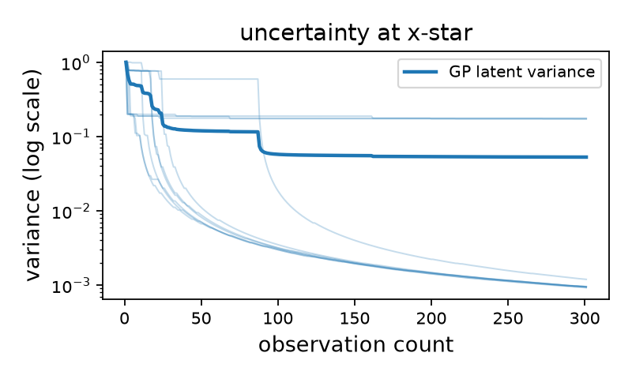
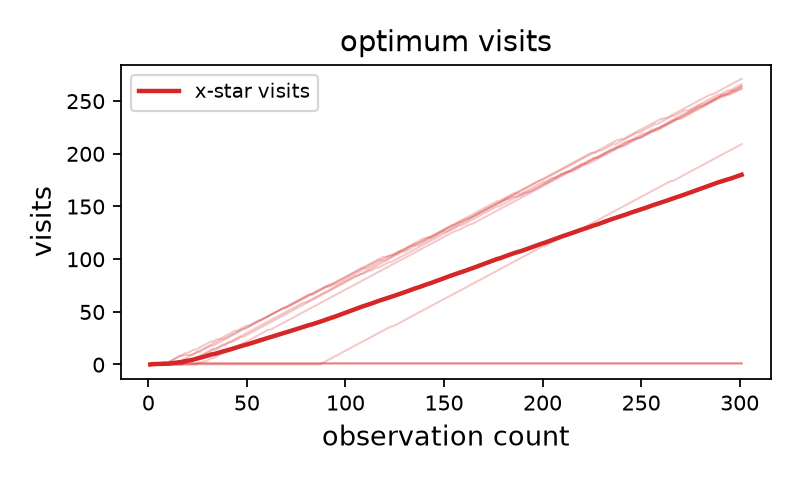
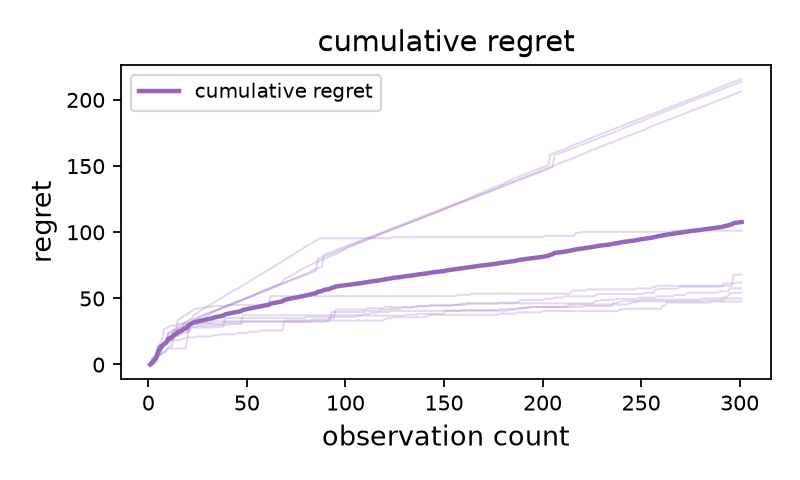

# lfbotheory: neural randomized optimization

This is a compact approximate-Thompson-sampling experiment for the finite-grid setting in the supplied paper (see [Reference](#reference) below). At observation count $t$, a fresh tanh MLP is initialized and optimized with the paper's general objective:

$$L_t(\theta; \theta_{t,0}) = \sum_{i=1}^{t} \ell\bigl(g_\theta(x_i),y_i\bigr) + R_t(\theta;\theta_{t,0}),$$

where the general regularizer is first the squared distance between the two
model functions,

$$
R_t(\theta;\theta_{t,0})
  = \frac{\lambda_t}{2}
    \left\|g_\theta-g_{\theta_{t,0}}\right\|_{\mathcal G}^{2}.
$$

Using the parameter-space RKHS representation, this is the squared distance
between the corresponding kernel sections,

$$R_t(\theta;\theta_{t,0})= \frac{\lambda_t}{2}\left\|k_\Theta(\cdot,\theta)-k_\Theta(\cdot,\theta_{t,0})\right\|_{\mathcal H_\Theta}^{2}.$$

For an arbitrary parameter-space kernel, the reproducing-property expansion is:

$$R_t(\theta;\theta_{t,0}) = \frac{\lambda_t}{2}\left[k_\Theta(\theta,\theta) + k_\Theta(\theta_{t,0},\theta_{t,0})- 2k_\Theta(\theta,\theta_{t,0})\right].$$

The default experiment uses a unit-diagonal, translation-invariant RBF kernel
with fixed lengthscale $\ell_\Theta = c\sqrt{M}$. The `matern` and
`rational_quadratic` alternatives are also unit-diagonal and
translation-invariant. Their two self-kernel terms are therefore both one, so
the full penalty becomes:

$$R_t(\theta;\theta_{t,0}) = \lambda_t\Bigl[1-k_\Theta(\theta,\theta_{t,0})\Bigr].$$

The first term, $\lambda_t$, is constant with respect to $\theta$ and cannot
change the optimizer. The code therefore minimizes the equivalent objective:

$$\widetilde{L}_t(\theta) = \sum_{i=1}^{t} \frac{1}{2}\bigl(g_\theta(x_i)-y_i\bigr)^2 - \lambda_t k_\Theta(\theta,\theta_{t,0}).$$

For a non-stationary kernel, $k_\Theta(\theta,\theta)$ may depend on $\theta$,
so the general self-kernel expression must be retained. The first grid
maximizer is the next query. The teacher is one frozen network, reused across
runs. The `linear` option uses this non-constant self-kernel case directly,
which gives the L2 penalty $\frac{\lambda_t}{2}\|\theta-\theta_{t,0}\|^2$.

The frozen teacher always uses Gaussian LeCun-normal initialization, with scale controlled independently by `--teacher-initialization-scale`. Policy networks use Gaussian LeCun-normal initialization by default; `--initialization kaiming_normal` and `--initialization xavier_uniform` are available for comparison. Use `--initialization-scale` to control the policy prior scale; for Xavier uniform this is the initialization gain. Biases are initialized to zero. The parameter-space regularizer is selected with `--regularizer-kernel`; Matérn regularizers accept `--regularizer-matern-nu` in `{0.5, 1.5, 2.5}`, and rational-quadratic regularizers use `--regularizer-rq-alpha`. The GP is diagnostic only. It uses a fixed direct Matérn kernel and exact latent posterior variance with ridge $\lambda_0$ (plus separately reported numerical jitter); it excludes observation noise. The ensemble is also diagnostic only and reports unbiased sample variance ($\mathrm{ddof}=1$). Neither changes policy actions.

## Example output

These example figures are generated from the $q=2$ schedule experiment and
show the diagnostic GP variance at the optimum, exact visits to the optimum,
and cumulative regret across policy seeds:

<p align="center">



</p>

## Run

Install the project and its dependencies in a virtual environment:

```bash
python -m venv .venv
source .venv/bin/activate
pip install -e .
```

The `.venv` path above is only an example. If you use a different virtual
environment location or environment manager, activate that environment before
running the commands below.

The CLI displays descriptions and defaults for every option:

```bash
python ts_variance_decay_experiment.py --help
```

`--seed` is a master seed. Unless explicitly supplied, it deterministically
generates independent seeds for the teacher, initial design, observation noise,
and policy runs. Use `--num-runs` to choose how many policy seeds to generate;
`--seeds` remains available when exact policy seeds are needed:

```bash
python ts_variance_decay_experiment.py \
  --output runs/smoke --rounds 8 --steps 80 --seed 0 --num-runs 1
python plot.py runs/smoke
```

Each policy seed runs in an independent subprocess. The parent process prepares
the shared teacher/design state once, launches all workers concurrently, and
logs a completion message as each worker exits. Worker output includes the
process ID so concurrent fit logs can be distinguished. Each worker also owns
a `tqdm` progress bar updated once per policy iteration.

For a modest matched pilot:

```bash
python ts_variance_decay_experiment.py \
  --output runs/pilot_log --seed 0 --num-runs 4 --rounds 30 --steps 300
python plot.py runs/pilot_log
```

## Reproducing the paper experiments

Three independent release scripts reproduce the experiment groups used in the
paper: logarithmic schedules, initialization priors, and regularization
kernels. Each script also generates the corresponding comparison figures:

```bash
bash scripts/schedule_experiments.sh
bash scripts/prior_experiments.sh
bash scripts/kernel_experiments.sh
```

The teacher uses a fixed Gaussian LeCun-normal prior with scale $8$. The
teacher, initial-design, and observation-noise seeds are fixed across all
groups, while policy seeds are generated reproducibly from master seed `1987`.
This keeps the objective and initial design fixed when comparing policy priors
or regularization kernels. The generated `runs/` and `comparisons/` directories
are intentionally ignored by Git.

### `scripts/schedule_experiments.sh`

Runs four 300-round experiments with the logarithmic regularization schedule
$\lambda_t=0.25[1+\log(1+t)]^q$ for $q\in\{1,2,3,4\}$. Each configuration uses
10 policy seeds, a LeCun-normal policy scale of $8$, and the RBF regularizer.
The script writes per-run plots under `runs/pilot-log-q-*` and comparison plots
under `comparisons/paper-schedule`.

### `scripts/prior_experiments.sh`

Runs five 100-round experiments with the RBF regularizer: LeCun-normal policy
scales $1$, $4$, $8$, and $16$, plus a Xavier-uniform policy prior. Each
configuration uses 5 policy seeds. The script writes per-run plots under
`runs/pilot-gaussian-*` and `runs/pilot-uniform`, and comparison plots under
`comparisons/paper-prior`.

### `scripts/kernel_experiments.sh`

Runs three 100-round experiments with LeCun-normal policy scale $8$, comparing
Matérn ($\nu=2.5$), RBF, and rational-quadratic parameter-space regularizers.
Each configuration uses 5 policy seeds. The script writes per-run plots under
`runs/pilot-matern`, `runs/pilot-rbf`, and `runs/pilot-rq`, and comparison plots
under `comparisons/paper-kernel`.

Run the scripts from the repository root after installing the project. Each
script refuses to overwrite non-empty run directories; use a fresh output
directory or remove old ignored artifacts before rerunning an experiment.

Pass `--plot` to run `plot.py` automatically after the experiment completes.
Plot options can be forwarded with `--plot-out`, `--plot-max-iterations`,
`--plot-gp-only`, `--plot-font-size`, `--plot-figsize-width`,
`--plot-figsize-height`, and `--plot-no-titles`.

Compare the aggregate variance decay of two runs, for example a logarithmic
and a constant regularization schedule:

```bash
python compare.py runs/pilot_log runs/pilot_constant \
  --metric gp_variance --out comparisons/schedules
```

The comparison legend uses each run directory's base name as its label. Each
line is the mean across that run's policy seeds, with a shaded $\pm 1$ standard
error band.
Available comparison metrics are:

- `gp_variance`: diagnostic GP latent variance at the optimum.
- `ensemble_variance`: diagnostic ensemble sample variance at the optimum.
- `simple_regret`: current gap between the true grid optimum and the best queried point.
- `cumulative_regret`: running sum of the simple regret.
- `optimum_visits`: number of exact visits to the grid optimum.

Most options accept both underscore and hyphen spellings, for example
`--initial_size` and `--initial-size`. Scientific settings such as grid size,
network width, optimizer steps, schedule, GP kernel, ensemble frequency, and
snapshot frequency are all configurable from the CLI.

Progress is reported through Python logging rather than `print`. Use
`--log-level INFO` for run-level progress or `--log-level DEBUG` for per-fit
timing, query, and diagnostic details.

The current plotting code does not fit a Lemma 4.3 rate reference; `d_eff` and
`rate_window` are retained as documented configuration placeholders for that
future plot and do not affect training or selection.

Use `--schedule constant` for an ablation. A rate reference is intentionally not plotted by default: if enabled later, $d_\mathrm{eff}$ must be explicit, the scale must be fit on a declared window, and the result is only a fitted reference—not a theorem bound or evidence of kernel domination. The current plot reports variance, not standard deviation.

Each run saves `teacher.pt`, teacher metadata and grid, raw arrays, aligned per-observation-count records, snapshots, and package/platform configuration. Existing non-empty seed directories are never overwritten.

The summary plots report GP and ensemble variance at the optimum, simple regret,
cumulative regret, and exact optimum visits as separate figure files. Individual
seed traces are shown with their aggregate means; regret uses the teacher's true
finite-grid values, not noisy observations. Use `--max-iterations` to truncate
the summary plots to an initial observation-count prefix, or `--gp-only` to
omit ensemble estimates from the uncertainty and snapshot plots.

## CLI reference

The public options are listed below. Multiword options accept either
underscore or hyphen spelling, such as `--initial_size` or `--initial-size`.

### `ts_variance_decay_experiment.py`

Core and reproducibility:

- `--output`: run and artifact directory. Default: `runs/smoke`.
- `--log-level`: logging verbosity. Default: `INFO`.
- `--plot`: run `plot.py` after all policy subprocesses finish. Default: disabled.
- `--plot-out`: plot output directory when `--plot` is enabled. Default: `None`.
- `--plot-max-iterations`: maximum observation-count iterations to plot. Default: `None`.
- `--plot-gp-only`: show only GP latent variance in the uncertainty plot. Default: disabled.
- `--plot-font-size`: master plot font size in points; other sizes are derived from it. Default: `10.0`.
- `--plot-figsize-width`: plot figure width in inches. Default: `7.0`.
- `--plot-figsize-height`: plot figure height in inches. Default: `4.0`.
- `--plot-no-titles`: omit titles from generated plots. Default: disabled.
- `--seed`: master seed used to derive unspecified experiment seeds. Default: `0`.
- `--num-runs`: number of policy runs when `--seeds` is not provided. Default: `1`.
- `--seeds`: directly specified policy seeds; overrides `--seed` and `--num-runs` for policy runs. Default: `None`.
- `--teacher-seed`: frozen teacher seed; derived from `--seed` when omitted. Default: `None`.
- `--initial-seed`: initial-design seed; derived from `--seed` when omitted. Default: `None`.
- `--noise-seed`: observation-noise seed; derived from `--seed` when omitted. Default: `None`.

Domain and network:

- `--input-dim`: input dimension. Default: `1`.
- `--grid-size`: 1D grid size, or approximate total grid size in higher dimensions. Default: `41`.
- `--lower`, `--upper`: coordinate bounds. Defaults: `-1.0`, `1.0`.
- `--hidden`: width of each hidden tanh layer. Default: `16`.
- `--layers`: number of hidden tanh layers. Default: `2`.
- `--initialization`: policy initialization: `lecun_normal`, `kaiming_normal`, or `xavier_uniform`. Default: `lecun_normal`.
- `--initialization-scale`: policy Gaussian standard-deviation multiplier, or Xavier gain. Default: `1.0`.
- `--teacher-initialization-scale`: scale of the frozen teacher's Gaussian LeCun-normal initialization. Default: `1.0`.

Training and schedule:

- `--teacher-noise`: observation-noise standard deviation. Default: `0.04`.
- `--initial-size`: number of initial-design observations. Default: `3`.
- `--rounds`: sequential query rounds. Default: `20`.
- `--steps`: optimizer steps per fresh fit. Default: `250`.
- `--learning-rate`: optimizer learning rate. Default: `0.03`.
- `--optimizer`: `adam` or `sgd`. Default: `adam`.
- `--schedule`: `log` or `constant` regularization schedule. Default: `log`.
- `--lambda-base`: lower bound $\lambda_0$ and GP ridge. Default: `0.5`.
- `--schedule-q`: logarithmic schedule exponent. Default: `1.5`.
- `--theta-lengthscale-c`: multiplier in $\ell_\Theta = c\sqrt{M}$. Default: `1.0`.
- `--regularizer-kernel`: parameter-space kernel: `linear`, `rbf`, `matern`, or `rational_quadratic`. Default: `rbf`.
- `--regularizer-matern-nu`: Matérn regularizer smoothness; allowed values are `0.5`, `1.5`, or `2.5`. Default: `2.5`.
- `--regularizer-rq-alpha`: rational-quadratic regularizer shape parameter. Default: `1.0`.

Diagnostics:

- `--gp-lengthscale`: fixed input-space Matérn lengthscale. Default: `0.35`.
- `--gp-nu`: fixed Matérn smoothness; allowed values are `0.5`, `1.5`, or `2.5`. Default: `2.5`.
- `--gp-jitter`: numerical GP jitter. Default: `1e-6`.
- `--ensemble-members`: diagnostic ensemble size; `0` disables it. Default: `5`.
- `--ensemble-frequency`: ensemble frequency in diagnostic counts. Default: `1`.
- `--snapshot-frequency`: full-grid snapshot frequency; `0` disables snapshots. Default: `5`.
- `--d-eff`: reserved effective dimension for a future rate reference. Default: `None`.
- `--rate-window`: reserved rate-fitting window. Default: `2:20`.
- `--device`: Torch device. Default: `cpu`.

### `plot.py`

- `root`: saved experiment directory. Required.
- `--out`: output directory for plots. Default: `ROOT/plots`.
- `--max-iterations`: maximum number of observation-count iterations in summary plots. Default: `None`.
- `--gp-only`: omit ensemble estimates from uncertainty and snapshot plots. Default: disabled.
- `--font-size`: master plot font size in points; other sizes are derived from it. Default: `10.0`.
- `--figsize-width`: figure width in inches. Default: `7.0`.
- `--figsize-height`: figure height in inches. Default: `4.0`.
- `--no-titles`: omit titles from all generated plots. Default: disabled.
- `--d-eff`: reserved effective dimension for a future rate reference. Default: `None`.
- `--rate-window`: reserved rate-fitting window. Default: `2:20`.
- `--log-level`: logging verbosity. Default: `INFO`.

### `compare.py`

- `roots`: one or more saved experiment directories. Required.
- `--out`: output directory. Default: `comparisons`.
- `--metric`: metric to compare: `gp_variance` (GP latent variance), `ensemble_variance` (ensemble sample variance), `simple_regret` (current optimum gap), `cumulative_regret` (running regret sum), or `optimum_visits` (exact optimum visits). Default: `gp_variance`.
- `--max-iterations`: maximum number of observation-count iterations to plot. Default: `None`.
- `--font-size`: master plot font size in points; other sizes are derived from it. Default: `10.0`.
- `--figsize-width`: figure width in inches. Default: `7.0`.
- `--figsize-height`: figure height in inches. Default: `4.0`.
- `--log-y`: force a logarithmic y-axis for the comparison metric. Default: disabled.
- `--no-titles`: omit the title from the comparison plot. Default: disabled.
- `--log-level`: logging verbosity. Default: `INFO`.

## Checks and limitations

Run the focused checks with:

```bash
ruff check .
python -m unittest -q test_experiment.py
```

The implementation keeps policy, teacher, initial-design, observation-noise, and ensemble seeds separate; repeated observations remain in GP matrices; ties use the first grid index; and the paper's unique finite-grid optimum is checked. Numerical tests cover the regularizer gradient, duplicate-input GP conditioning, deterministic replay, and diagnostic independence. Finite optimization is approximate, so failed fits must be interpreted honestly. This pilot does not establish theorem assumptions, model-kernel domination, or asymptotic variance decay.

## Reference

This implementation accompanies the following paper, to appear at NeurIPS 2026:

> Oliveira, Rafael. “Kernel-based guarantees for nonlinear parametric models in Bayesian optimization.” In *Advances in Neural Information Processing Systems 39 (NeurIPS 2026)*, 2026.

ArXiv preprint: https://arxiv.org/abs/2605.13160

BibTeX:

```bibtex
@inproceedings{oliveira2026kernel,
  author    = {Oliveira, Rafael},
  title     = {Kernel-based guarantees for nonlinear parametric models in Bayesian optimization},
  booktitle = {Advances in Neural Information Processing Systems 39},
  year      = {2026},
}
```
